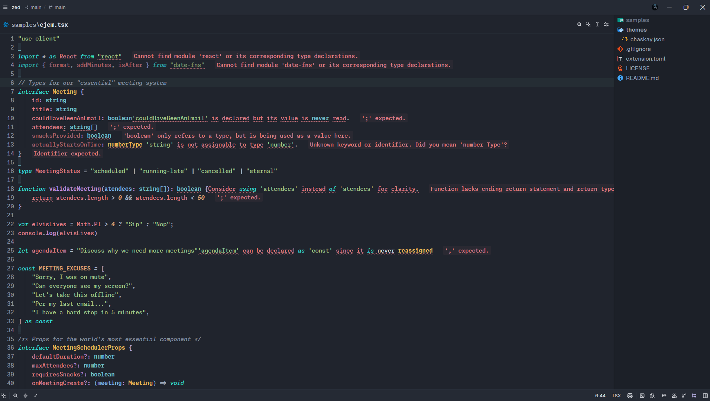

# Chaskay

> A calm, modern dark theme for [Zed](https://zed.dev).

[](https://zed.dev)
[](https://github.com/chaskay/zed)
[](LICENSE)



Chaskay is a carefully tuned dark theme designed to keep code readable and the interface comfortable during long coding sessions. It combines a cool slate background with soft lavender accents and balanced syntax colors.

## Highlights

- Dark, low-distraction interface
- Soft lavender accents for focus and selection
- Comfortable contrast for editors, panels, terminals, and tabs
- Balanced syntax colors for common programming languages
- Transparent borders and subtle surfaces to keep the UI clean

## Installation

### Development installation

1. Clone or download this repository.
2. Open the **Command Palette** in Zed.
3. Run **`zed: install dev extension`**.
4. Select the repository folder.
5. Open **Settings → Theme** and choose **Chaskay**.

> This repository currently provides a development extension installation. It is not published to the Zed extension marketplace yet.

## Color palette

| Role | Color |
| --- | --- |
| Background | `#20242D` |
| Surface | `#252A34` |
| Text | `#D7D9DF` |
| Muted text | `#A2ABBA` |
| Accent | `#B4ACDF` |
| Blue | `#76ACE0` |
| Green | `#A0C58A` |
| Yellow | `#DFC184` |
| Red | `#DF7D86` |

## Project structure

```text
.
├── themes/
│   └── chaskay.json   # Theme definition
├── extension.toml     # Zed extension metadata
└── LICENSE
```

## Development

Theme changes can be tested directly in Zed by reinstalling the development extension from the Command Palette. The theme definition lives in [`themes/chaskay.json`](themes/chaskay.json).

Suggestions and improvements are welcome. If you find an issue with contrast, syntax highlighting, or a specific Zed component, please open an issue with a screenshot and the affected context.

## License

Chaskay is released under the [MIT License](LICENSE).
